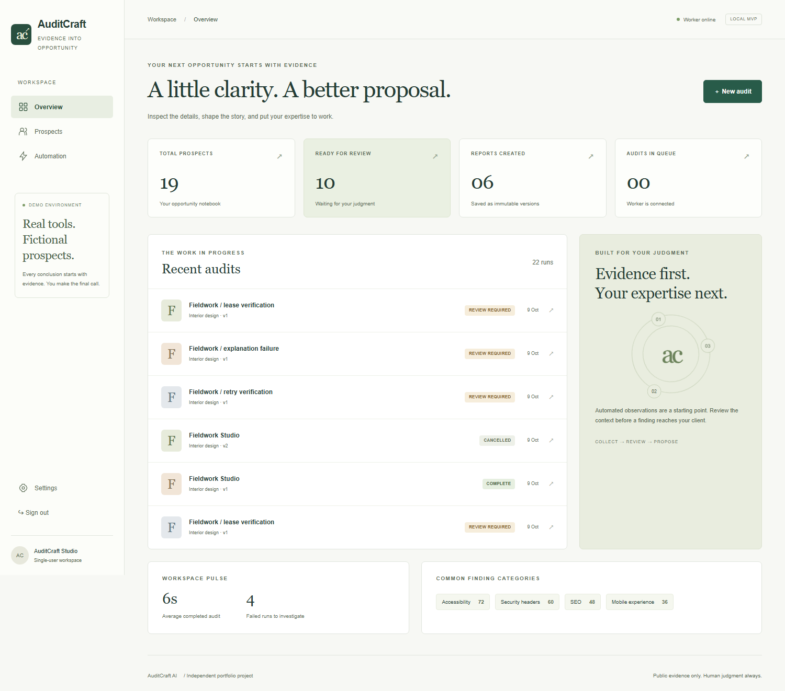

# AuditCraft AI

## Public portfolio demo

[Open the public demo](https://auditcraft-ai.vercel.app). Source and deployment instructions are in [`demo/`](demo/README.md). It uses recorded fictional evidence and supports review edits and JSON export without signup. The sample PDF is a previously finalized report. This demo does not run fresh audits or call live AI providers. For Vercel, set the repository Root Directory to `demo`; no backend services or environment variables are needed.

**Measurable website evidence → reviewable findings → a human-approved proposal.**

AuditCraft reduces the repetitive work behind a freelancer's website review: capture pages, record observations, interpret findings, obtain human approval and produce a branded report. The current release is a **single-user, fixture-only portfolio MVP**, not a production service or a live prospect-scanning tool.

“AuditCraft AI is an independent portfolio and internal-operations project inspired by recurring requirements in real freelance website-audit and proposal-automation briefs. It is not presented as commissioned client work.”



## Run locally

Requirements: Node.js 22+ (Node 24 used locally), Docker Desktop with Linux containers, npm, approximately 3 GB of free disk space for the browser image. Ports 3100, 55432 and 56379 must be free.

```powershell
cd D:\Projects\auditcraft-ai
npm ci
npm run setup
docker compose up --build -d
docker compose exec web npm run seed
```

Open **http://localhost:3100**. Sign in with `ADMIN_PASSWORD` in the ignored `.env` file created by setup. Do not commit or share it. Setup preserves an existing `.env`. PostgreSQL and Redis bind to loopback only; the worker has no published port.

Choose **New audit**, retain the fictional Fieldwork URL, confirm responsible use and start. Review the screenshots and evidence, approve findings, then open **Report** and finalize a version. The worker generates the PDF. Download it and edit/export the outreach draft. Nothing sends an email.

The seed command creates a queued fictional prospect, a real first-attempt retry demonstration and a clearly labeled stored failure example. It is idempotent. The complete sample PDF and captures are also checked into `output/` for offline review.

### Development without rebuilding Docker

```powershell
docker compose up -d postgres redis
npm run migrate
npx playwright install chromium
npm run dev
# In a second terminal:
npm run worker
# In a third terminal:
npm run seed
```

Do not run a host worker and a Compose worker simultaneously while conducting crash-recovery tests. Stop host development before starting Compose web on port 3100.

## Implemented workflow

- Password-protected dashboard, prospect history/statuses, audit queue and stage timeline.
- Durable PostgreSQL records plus BullMQ retries, cancellation, worker heartbeat and SQL-outbox reconciliation.
- Isolated Chromium fixture captures at 1440×1000 and 390×844, both full-page and above the fold.
- axe-core accessibility, DOM metadata/structure/mobile checks, controlled response-header inspection and PerformanceObserver lab values.
- Evidence records with provenance, confidence, severity, expected value, timestamp and explicit scoring deductions.
- Replaceable explanation-provider interface with a strict deterministic template provider. **No live LLM integration.**
- Split screenshot/finding review, manual findings, revision history, approval/rejection and display order.
- Configurable branding, services, limits and scoring weights.
- Immutable HTML/report snapshots, asynchronous branded PDF, screenshots, evidence references and scoring ledger.
- Editable, revisioned outreach drafts derived from approved report findings; text export only.

## Evidence, interpretation and AI

Deterministic tools produce observations and scores. The mock provider supplies reproducible, check-specific explanations, marked as template-assisted. It cannot add approval. Unknown IDs, empty references, unrecognized prose, numeric inventions and approval injection are rejected. Failure leaves evidence available for manual review.

External AI prose cannot be reliably fact-checked with a few regular expressions. This release intentionally accepts only exact approved template structures. The provider interface is an extension point; it is not a tested OpenAI or Ollama integration. Human-edited language is marked as such, checked for obvious unsupported numbers/guarantees, and remains the reviewer's responsibility.

## URL security and responsible use

The public URL policy rejects non-HTTP schemes, credentials, unsupported ports and non-global IPv4/IPv6 addresses after DNS resolution. It revalidates redirect policy and detects mixed private/public answers. **This validator is not a safe live browser transport by itself.**

The executable scanner accepts only the exact fixture origin and controlled paths. Playwright fulfills those requests from stored strings, aborts every other request and closes websockets. Service workers and downloads are disabled. There is no localhost exception or private-network bypass in any mode. The fixture is deterministic, fictional and does not contact a real third-party site.

Live public-site auditing is disabled until a pinned-IP egress transport, real robots enforcement, redirects, resource limits and DNS-rebinding defenses can be verified end to end. No authentication/CAPTCHA bypass, penetration testing, arbitrary ports, platform scraping, bulk prospecting or sensitive data collection is implemented. See [responsible use](docs/RESPONSIBLE-USE.md) and [threat model](docs/THREAT-MODEL.md).

## Scoring and approval

Defaults: Performance 25, Accessibility 20, SEO 20, Mobile 15, Technical 10, Headers 10. Category score is `max(0, 100 - sum(evidence deductions))`. Weighted results are normalized over measured categories. Missing categories reduce coverage; they do not become severe findings. A category containing some measurements is not proof of complete audit coverage. [Full methodology](docs/SCORING.md).

Only selected approved findings enter final reports. Rejected findings stay in history. Deterministic scores and their ledger retain all observations, including evidence whose proposed interpretation was rejected. Final reports copy evidence, findings, settings and scoring into immutable snapshots. Later review edits and reruns cannot change them.

## Verification

```powershell
npm test
npm run typecheck
npm run lint
npm run build
# With the local complete stack and a reachable worker health endpoint:
npm run test:integration
npm run test:browser
```

For the Docker stack's unexposed worker health endpoint, run integration inside the web container:

```powershell
docker compose exec -e API_BASE=http://web:3100 -e WORKER_URL=http://worker:3101 web npm run test:integration
```

The integration runner uses `API_BASE` for container addressing and retains `APP_URL` as the CSRF origin.

Tests create fictional data and reports. They do not delete existing history. For detailed actual results and untested boundaries, read [verification](docs/VERIFICATION.md). Compilation alone is not a workflow test. The sample PDF is rendered and visually reviewed separately.

## Production limitations

- No live website scanning, real robots fetching, Lighthouse, Speed Index, field data, external AI, email sending, billing or third-party integrations.
- No full keyboard/focus, overlap, journey or legal/compliance assessment. Header presence is not proof of adequate policy configuration.
- Local HTTP cookie is appropriate only for a loopback demo. Public deployment needs TLS, secure cookies, identity hardening, per-user authorization, quotas, managed secrets, backup/restore verification and hardened browser egress/isolation.
- PostgreSQL/Redis demo credentials are local-only defaults. Containers share a private network; a compromised browser process requires stronger OS/network containment for hostile sites.
- Artifacts are retained on disk without a retention/garbage-collection policy. This is not a multi-user service.
- No claims of revenue, conversion, rankings, commissioned delivery, accessibility certification, security certification or production readiness.

## Engineering references

[Architecture decision](docs/ADR-001.md) · [Architecture and data flow](docs/ARCHITECTURE.md) · [Reviewer guide](docs/REVIEWER-GUIDE.md) · [API](docs/API.md) · [Worker](docs/WORKER.md) · [Report methodology](docs/REPORT-METHODOLOGY.md) · [Case study](docs/CASE-STUDY.md) · [Troubleshooting](docs/TROUBLESHOOTING.md)

License: MIT.
