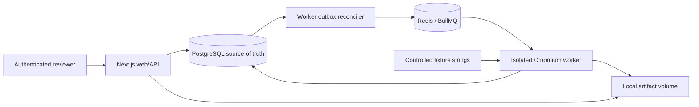
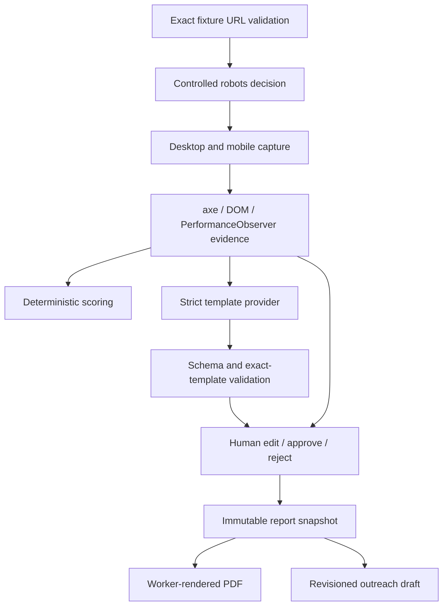

# Architecture and data flow

## Storage contract

`prospects` own versioned `audits`. An audit owns captures, evidence, findings and events. Each finding owns append-only prior revisions. Reports hold immutable JSON and HTML snapshots; artifacts hold mutable PDF job state separately. Outreach inserts a new row per revision. Settings apply to future runs; audit-scoring weights are frozen at creation. Foreign keys and transaction locks prevent cross-audit references through service validation and serialize report finalization with review edits.

PostgreSQL is authoritative. Redis loss cannot erase evidence or reports. The worker reconciles unfinished SQL rows into missing BullMQ jobs, bounded by persistent audit attempt count. BullMQ locks and stalled-job handling recover worker crashes. Failed/manual retries produce a new audit version, preserving the old record.

## Trust boundaries

Browser input → authenticated API → validated database writes. Worker output → normalized evidence → template validation → human approval → immutable report. The screenshot browser only receives controlled fixture resources. PDF Chromium receives stored escaped HTML and an embedded approved capture with all network traffic blocked.

PDF generation uses the saved HTML, not a later template re-render, so queued reports keep their original layout. Report artifact bytes are written atomically then marked READY. Reports do not expose arbitrary file paths.
